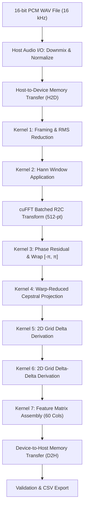

# Software & Hardware Architecture

## 1. Pipeline Data Flow

## 2. CUDA Kernel Responsibilities

| Kernel Function | Block Configuration | Grid Configuration | Memory Access Pattern | Optimization Mechanism |
|---|---|---|---|---|
| `audio_framing_and_rms_kernel` | 512 threads (1D) | $T$ blocks (1 per frame) | Global read from continuous audio, zero-padded write | Shared memory tree reduction for RMS calculation |
| `apply_hann_window_kernel` | 512 threads (1D) | $T$ blocks (1 per frame) | Coalesced read/write on padded frames | Direct register multiplication with window cache |
| `cufftExecR2C` | Managed by cuFFT | Batched across $T$ frames | Contiguous strided 512-to-257 complex buffer | Highly optimized NVIDIA batched transform |
| `compute_phase_residual_kernel` | 256 threads (1D) | $T$ blocks (1 per frame) | Reads complex bins, writes residual vector | Fast intrinsic `atan2f`, branchless gating |
| `extract_cepstral_features_kernel` | 256 threads (1D) | $T$ blocks (1 per frame) | Shared memory staging of 256 residual bins | Warp shuffle primitives (`__shfl_down_sync`) |
| `compute_delta_features_kernel` | $16 \times 16$ threads | 2D Grid ($T/16 \times 20/16$) | Coalesced row-major reads across time frames | Clamped boundary arithmetic in registers |
| `compute_delta_delta_features_kernel` | $16 \times 16$ threads | 2D Grid ($T/16 \times 20/16$) | Coalesced reads from delta buffer | Identical 5-point regression operator |
| `assemble_feature_matrix_kernel` | $16 \times 16$ threads | 2D Grid ($T/16 \times 60/16$) | Merges static, delta, delta-delta into $T \times 60$ | Fully aligned global writes |

## 3. Timing and Profiling Points
- `ev_start_h2d` to `ev_end_h2d`: Measures host-to-device memory transfer latency.
- `ev_start_kernel` to `ev_end_kernel`: Measures asynchronous CUDA kernel execution and cuFFT execution excluding host interaction.
- `ev_start_d2h` to `ev_end_d2h`: Measures device-to-host memory transfer latency.
- High-resolution C++ `std::chrono` timers capture end-to-end application throughput.
