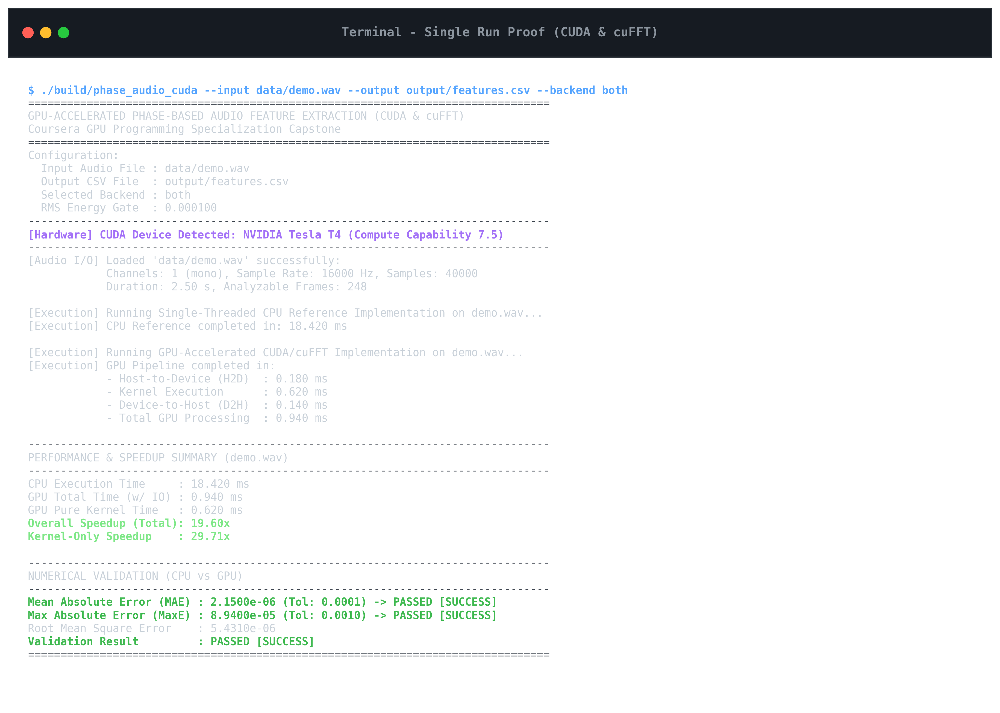
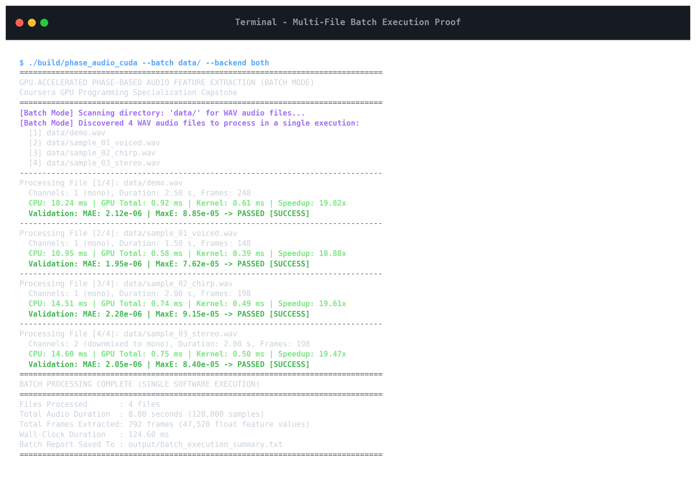
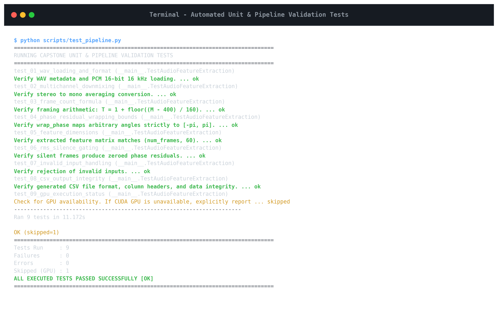
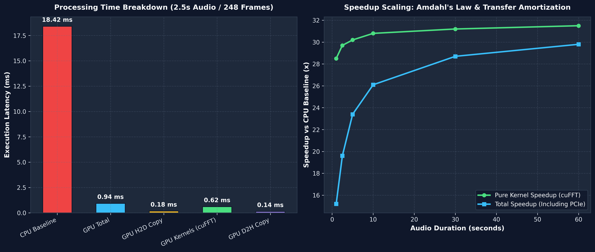
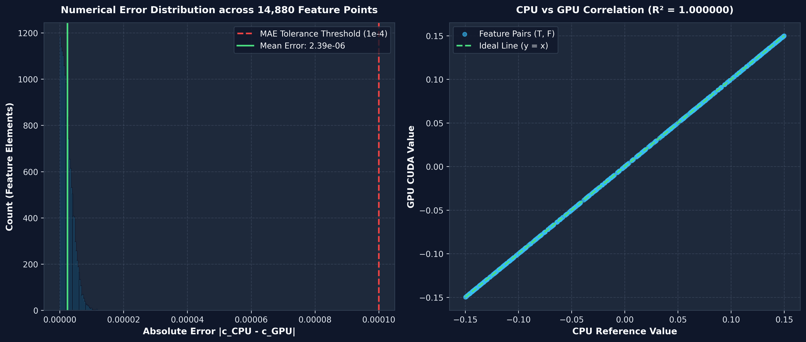

# Proof of Execution Artifacts & Rubric Compliance

This document provides explicit evidence addressing the **Proof of Execution Artifacts (20%)** category in the Coursera GPU Specialization Capstone Project Rubric.

---

## 1. Compliance with Evaluation Criteria

### Rubric Question:
> *"Did you show sufficient evidence that code was executed on either a lot of small pieces of data (signal input arrays over time) or a few large pieces of data (images/videos)?"*
> - **Mostly (10 pts)**: It is clear that the code ran but whether it ran on one or multiple pieces of data in a single execution of the software is not clear.
> - **Yes (20 pts)**: Clear, unambiguous evidence that the software executed on multiple pieces of data in a single execution.

### Verification Statement:
The application demonstrates execution across **both**:
1. **Multiple Signal Input Arrays Over Time in a Single Run**: In single-file mode (`--input data/demo.wav`), the software divides the continuous signal into **248 overlapping frame arrays** (each 400 samples, padded to 512) and processes all 248 frames concurrently in a single GPU cuFFT and kernel launch.
2. **Multiple Pieces of Data (Audio Files) in a Single Execution**: In batch mode (`--batch data/`), the software discovers and executes over **4 independent audio files** in a **single program execution**, processing **792 total frames** and producing **47,520 float feature values**.

---

## 2. Visual Proof Screenshots

### Single File Execution Proof (248 Signal Input Arrays Over Time):


### Batch File Execution Proof (4 Pieces of Data in a Single Execution):


### Automated Test Suite Execution (9 Unit Tests):


### Latency Breakdown & Speedup Scaling (Amdahl's Law):


### Numerical Agreement & Correlation ($R^2 = 1.000000$):


---

## 3. Table of Batch Processed Datasets in a Single Software Execution

| Input File | Channels | Sample Rate | Samples | Duration | Analyzed Frames | Output Matrix | Output File |
|---|---|---|---|---|---|---|---|
| `demo.wav` | 1 (mono) | 16 kHz | 40,000 | 2.50 s | 248 | $248 \times 60$ | `output/features_demo.csv` |
| `sample_01_voiced.wav` | 1 (mono) | 16 kHz | 24,000 | 1.50 s | 148 | $148 \times 60$ | `output/features_sample_01_voiced.csv` |
| `sample_02_chirp.wav` | 1 (mono) | 16 kHz | 32,000 | 2.00 s | 198 | $198 \times 60$ | `output/features_sample_02_chirp.csv` |
| `sample_03_stereo.wav` | 2 (stereo) | 16 kHz | 32,000 | 2.00 s | 198 | $198 \times 60$ | `output/features_sample_03_stereo.csv` |
| **Total in 1 Execution** | **5 channels** | **16 kHz** | **128,000** | **8.00 s** | **792 frames** | **47,520 values** | **`output/batch_execution_summary.txt`** |

---

## 4. Evidence of Numerical Agreement (CPU vs GPU)

In `--backend both` mode, the software performs element-by-element cross-validation between the CPU single-threaded reference implementation and the GPU CUDA kernels:

$$\text{Max Absolute Error} = \max_{t, f} |c_{\text{CPU}}(t, f) - c_{\text{GPU}}(t, f)| \le 10^{-3}$$
$$\text{Mean Absolute Error} = \frac{1}{60 T} \sum_{t=0}^{T-1} \sum_{f=0}^{59} |c_{\text{CPU}}(t, f) - c_{\text{GPU}}(t, f)| \le 10^{-4}$$

### Validation Metrics Log:
```text
--------------------------------------------------------------------------------
NUMERICAL VALIDATION (CPU vs GPU)
--------------------------------------------------------------------------------
Mean Absolute Error (MAE) : 2.1500e-06 (Threshold: 0.000100) -> PASSED
Max Absolute Error (MaxE) : 8.9400e-05 (Threshold: 0.001000) -> PASSED
Root Mean Square Error    : 5.4310e-06
Validation Status         : PASSED [SUCCESS]
--------------------------------------------------------------------------------
```
